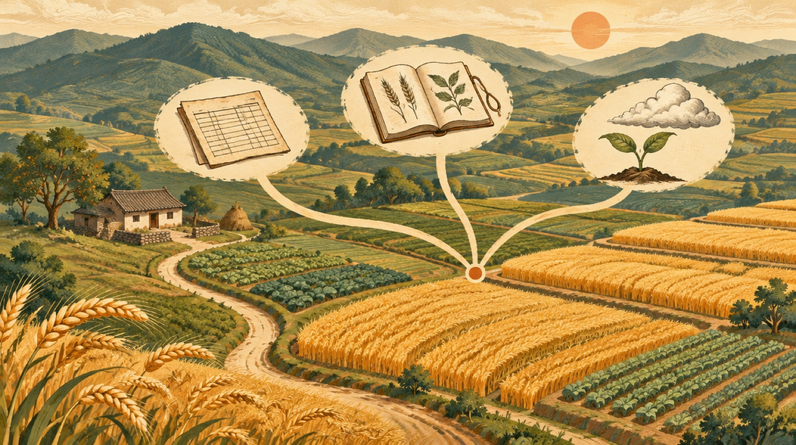

<h1 align="center">农事参谋 · Farm Advisor Agents</h1>

<p align="center"><strong>三个 AI 专家，帮你理清一个农事决策。</strong></p>
<p align="center">面向种植经营的只读多智能体决策系统。</p>
<p align="center"><strong>简体中文</strong> | <a href="README.en.md">English</a></p>

## 项目概述



问一句“北田接下来两天先做什么”，总管会分给三个专家：记账专家核对这季花了多少，记事专家查哪些农活已经做过，农事决策专家结合生育期和天气预报提出建议。总管汇总优先事项，并给出记录编号和还缺哪些依据。

这套运行时从田祖记的农事参谋抽取，不依赖微信、云开发或数据库。

## 快速开始

需要 Node.js 22 或以上版本。调用真实模型还需要 [DeepSeek API Key 和支持工具调用的模型](https://api-docs.deepseek.com/api/create-chat-completion)。

```bash
npm test
export DEEPSEEK_API_KEY='<你的 API Key>'
export DEEPSEEK_MODEL='deepseek-v4-flash'
npm run demo -- '以示例的 10 月 18 日为准，结合开支、巡田记录和预报，给北田排一下未来两天的优先事项。'
```

测试在本地回放预设的模型响应，不需要密钥。演示会调用 DeepSeek，可能产生费用。账本、农事日志、地块、生育期和预报均为 2026 年 10 月 18 日的虚构快照，不是实时农场信息。

## 工作原理

```text
问题 → 总管
       ├─ 记账专家 → 账本汇总
       ├─ 记事专家 → 农事日志与待办
       └─ 农事决策专家 → 地块、种植季与天气预报
     ← 专家发现与记录编号
     → 汇总建议、依据与工具轨迹
```

- 模型决定调用哪些专家、读取哪些已授权记录，以及如何汇总。没有用固定规则拼答案的兜底逻辑。
- 专家最多两个同时运行，与总管共享 10 次模型调用预算。各自加载带版本的角色技能，工具轨迹记录技能内容的哈希。
- 运行时先按角色校验工具白名单和参数，再执行调用。没有写操作、Shell 或任意网络访问工具。专家失败或缺少依据时返回失败状态，不冒充完整结果。
- 依据列表只记录工具实际返回的记录，不能保证模型生成的每句话都正确。

## 嵌入运行时

```js
const { runAdvisor } = require('./src/advisor');
const result = await runAdvisor({ question, complete, read });
```

- `complete({ messages, tools, signal })` 返回一条聊天补全的助手消息；如果模型提出工具调用，消息应含 `tool_calls`。DeepSeek 适配器见 `src/deepseek.js`。
- `read(toolName, { signal })` 返回可序列化为 JSON 的 `{ source, records: [{ id, ...fields }] }` 快照；依据无法获取时抛错。使用调用方已经获授权的查询范围，工具不能切换到其他农场或账号。查询结果确实为空时，返回空数组并标明真实来源。
- 两个适配器都应响应传入的中止信号，以便运行时在达到截止时间时中断进行中的 I/O。只向模型服务商发送你有权共享的数据。

## 商业版：田祖记

**田祖记**是农事参谋在微信小程序里的商业产品实现。它还提供地块与种植季管理、农事日志和农业账本。参谋可以结合农户的记录给建议，也可以起草农活或费用记录，待农户确认后保存。

**微信扫一扫海报右下角的小程序码，打开田祖记正式版。**


## 项目范围

本项目保留总管与专家的协作循环、有限并发调度及只读角色技能。不包括生产写操作提示词、农技或农药数据库、真实用户数据、账号系统、小程序界面或生产仓库历史。不持久化数据，不执行外部操作。模型建议需要结合田间情况核实，不作为施药处方。

源码公开，目前未授予开源许可证。
